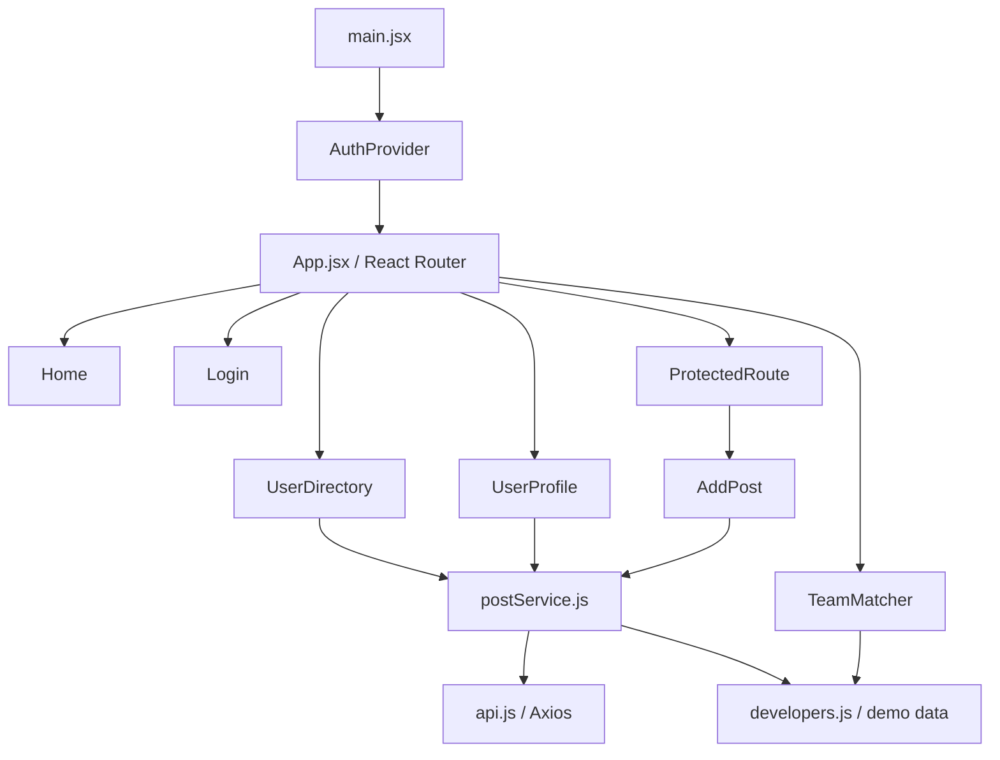

# DevMatch — Intelligent Developer Discovery & Team Formation

A React single-page app built on top of the DevDirectory lab brief. The differentiating feature is a transparent project-brief analyzer that extracts required skills, ranks developers, explains matches, and identifies potential team skill gaps.

## Features

- Responsive landing page and developer directory.
- Search by developer name, company, role, bio, or skill; filter by role and availability.
- Developer profile pages with skills, project highlights, and technical publications.
- **DevMatch Team Builder:** enter a project brief, detect skills from a keyword dictionary, rank the sample developer dataset, inspect match reasons, and spot missing skill coverage.
- Protected `/add-post` route with mock login and redirect back to the attempted route.
- Controlled post form with author dropdown, title/body length validation, loading/error/success states, and an Axios POST request.
- Central Axios client configured for `https://jsonplaceholder.typicode.com` with an 8-second timeout.
- Local demo data fallback when the public API is unavailable.
- Responsive layout for desktop and mobile.

## Run locally

Requirements: Node.js 18+ and npm.

```bash
npm install
npm run dev
```

Open the local URL printed by Vite (normally `http://localhost:5173`).

## Production check

```bash
npm run build
npm run preview
```

## Main routes

- `/` — overview and product introduction
- `/users` — searchable developer directory
- `/users/:id` — developer profile and publications
- `/match` — unique DevMatch project analyzer and team builder
- `/login` — demo authentication
- `/add-post` — protected article form
- `*` — not-found page

## Demo login

The login is intentionally a mock session for a frontend lab. Use any valid email address and a password with at least 6 characters. No real account or password is created. The session is held in `sessionStorage` for the current browser tab.

## Important demo limitations

- The team matcher is a deterministic, explainable keyword-based scoring engine over the local sample profiles. It does **not** call an external LLM and does not claim to be a trained AI model. It can be replaced later with an authenticated AI API if permitted.
- JSONPlaceholder is a mock API. It returns HTTP 201 for a successful POST, but new posts are not permanently saved by the service.
- The profile skills and sample projects are synthetic demo data; they are not verified real developer credentials.

## Architecture



## Project structure

```text
src/
├── components/   # Navbar, UserCard, loading, alerts, protected route
├── context/      # AuthContext
├── data/         # Sample developers and skill dictionary
├── hooks/        # useDebounce
├── pages/        # Home, directory, profile, matcher, login, post, 404
├── services/     # Configured Axios instance and API methods
├── App.jsx
├── main.jsx
└── styles.css
```

## Suggested viva explanation

**What is unique?** DevMatch does more than list developers or answer questions about the project. It reads a natural-language project brief, extracts the skills the brief mentions, compares them against developer profiles, gives a transparent match score, and shows which skills remain uncovered by the shortlisted team.

**How is matching calculated?** The current demo uses a skill dictionary with keyword synonyms. Each developer is ranked using the number of detected skills listed in their profile plus a small profile-signal bonus. The top three profiles are combined to compute overall skill coverage and remaining gaps. This approach is simple to demonstrate and explain; it is a heuristic, not an authoritative prediction of real-world performance.

**Future improvements:** save teams to a database, allow students to confirm skills, add verified GitHub portfolio signals with user consent, collect team feedback, and optionally connect a secured LLM API for richer requirement extraction.

## Deploy to Vercel

1. Push this repository to GitHub.
2. Import the repository in Vercel.
3. Framework preset: Vite.
4. Root directory: `./` (the folder containing `package.json`).
5. Build command: `npm run build`.
6. Output directory: `dist`.
7. Leave install command on the default setting.

The root `vercel.json` rewrites client-side routes to `index.html`, so routes such as `/users`, `/match`, and `/users/1` can be refreshed directly on the deployed SPA.
